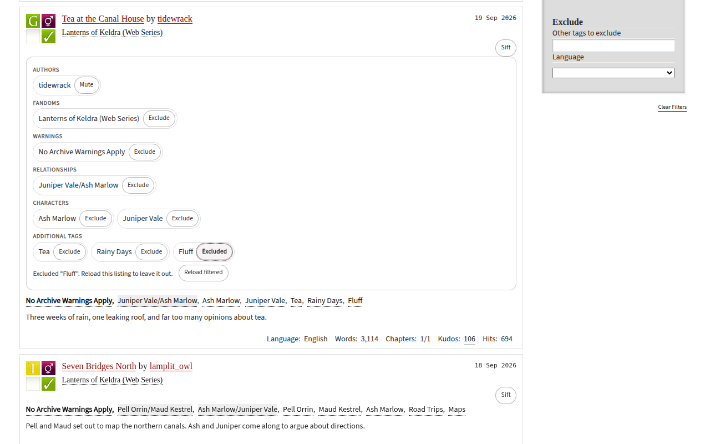
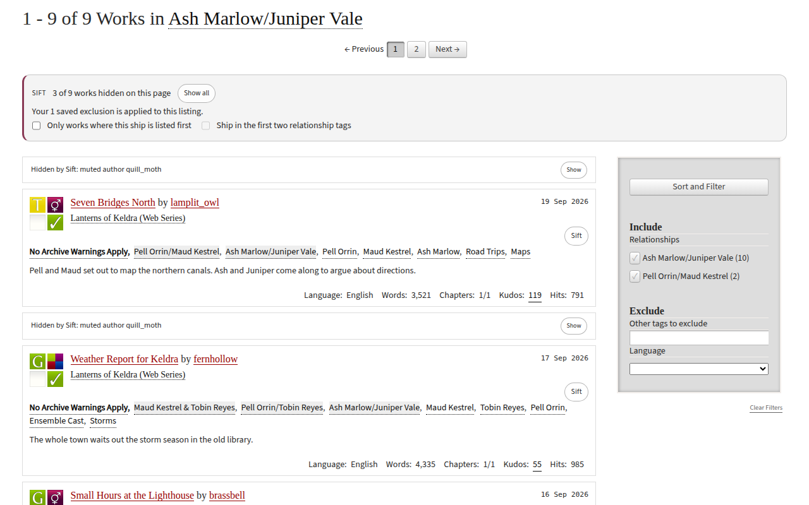
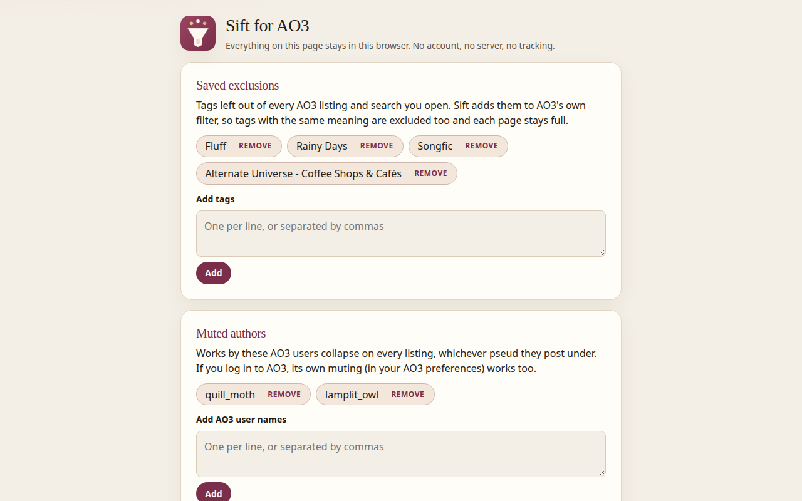
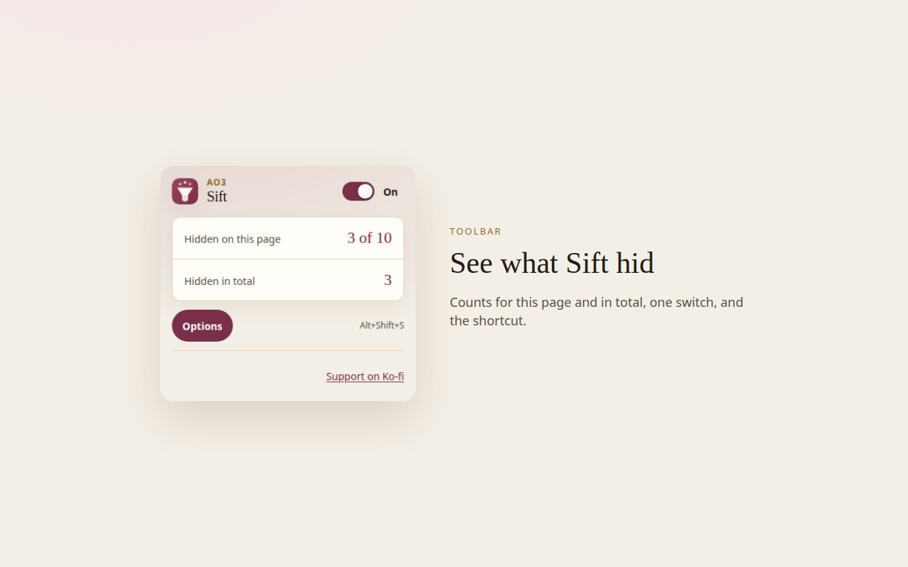

# Sift for AO3

**Make your AO3 filters stick: excluded tags on every search, muted authors, and fics where your ship comes first.**

[](https://chromewebstore.google.com/detail/nonieoiidaeaeheddaifgdmecgcbfgpl)
[](https://chromewebstore.google.com/detail/nonieoiidaeaeheddaifgdmecgcbfgpl)
[](https://github.com/cig13zs/sift-ao3/actions)
[](LICENSE)

[Install from the Chrome Web Store](https://chromewebstore.google.com/detail/nonieoiidaeaeheddaifgdmecgcbfgpl)

Sift is a private, offline browser extension for [Archive of Our Own](https://archiveofourown.org). Your lists stay in the browser. There is no account, no analytics, and no data sent to the author.

## Features

- **Primary ship filter** — On a relationship tag's works page, hide (or collapse) fics where that ship is not listed first, or optionally in the first two relationship tags. AO3 synonyms and subtags count as the same ship.
- **Saved tag exclusions** — Tags you exclude are added to AO3's own listing filter on every works or bookmarks listing you open via links on the site, so synonym tags are excluded and pages stay full.
- **Kept sidebar filters** — Complete/in-progress, language, crossover, and word-count choices from AO3's sidebar can be kept on every work listing, like exclusions.
- **Muted authors** — Hide works by an AO3 user on every listing, every pseud, including co-authored works, without logging in.
- **Per-work panel** — Press **Sift** on any work to mute its author or exclude any of its tags.
- **Popup** — Hidden counts for this page and in total, on/off switch, and link to options.
- **Options** — Manage lists, import/export JSON (including AO3 Savior-style backups), and behaviour toggles.
- **Keyboard shortcut** — `Alt+Shift+S` toggles Sift (customize at `chrome://extensions/shortcuts`).

## Screenshots










## Permissions

| Permission | Why Sift needs it |
|------------|-------------------|
| `storage` | Save your exclusions, muted authors, ships, kept filters, and on/off state locally in the browser. |
| `https://archiveofourown.org/*` (host) | Run the content script on AO3 only, rewrite listing links to carry your filters, and (when you enable a ship filter) fetch that ship's public tag page for synonym names — same origin only, no other sites. |

Sift does **not** request broad host access, `tabs`, scripting, or network permissions beyond AO3. Extension pages use a strict Content Security Policy: scripts load only from the package (`script-src 'self'`).

## Privacy

- All lists and settings live in **local extension storage** on your device. They are not synced to the developer and are not sent to any server Sift controls.
- Sift does not use analytics, ads, or remote code.
- Filter data is sent **only to AO3**, in listing URLs (the same way AO3's own filter form works). Ship synonym lookup loads one public AO3 tag page per ship, at most about once a week per ship.
- See [PRIVACY.md](PRIVACY.md) for the full policy.

## Install

**Chrome, Edge, Brave:** [Chrome Web Store listing](https://chromewebstore.google.com/detail/nonieoiidaeaeheddaifgdmecgcbfgpl)

**Firefox:** Add-ons listing is in review. Until then, download `sift-ao3-*-firefox.zip` from the [latest GitHub release](https://github.com/cig13zs/sift-ao3/releases/latest), unzip, and load the folder as a temporary extension.

**Development / unpacked:** run `npm run build`, then in `chrome://extensions` enable Developer mode and **Load unpacked** → `dist/chrome/`.

## Development

Requirements: [Node.js](https://nodejs.org/) 20+ (CI uses 24).

```bash
npm ci
npm run lint    # syntax + manifest security checks
npm test        # unit tests (src/lib/sift.js)
npm run build   # dist/chrome, dist/firefox, and zip files
npm run e2e     # Playwright loads unpacked build against synthetic AO3 pages
```

See [CONTRIBUTING.md](CONTRIBUTING.md) for guidelines.

## Changelog

See [CHANGELOG.md](CHANGELOG.md). Latest store-facing release in this repo: **1.1.1**.

## Security

Report vulnerabilities privately: [GitHub security advisories](https://github.com/cig13zs/sift-ao3/security/advisories/new) ([SECURITY.md](SECURITY.md)).

## Support and license

Sift is free [MIT](LICENSE) software by [jju1s](https://ko-fi.com/jju1s). Bug reports and ideas: [GitHub issues](https://github.com/cig13zs/sift-ao3/issues).

Sift is unofficial and not affiliated with the Organization for Transformative Works or Archive of Our Own.

## More tools by the same author

Other projects by [cig13zs on GitHub](https://github.com/cig13zs):