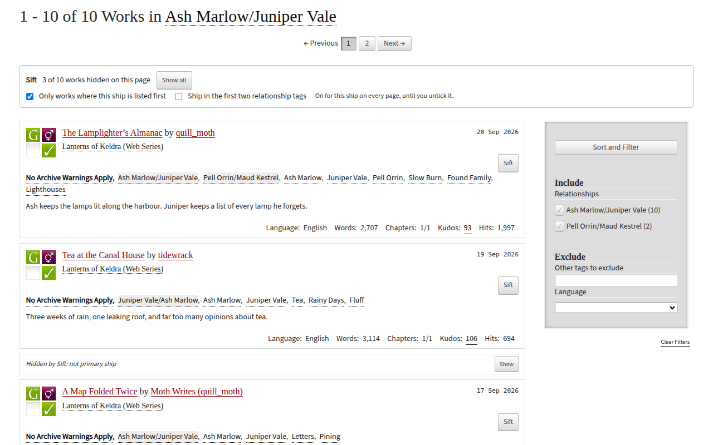
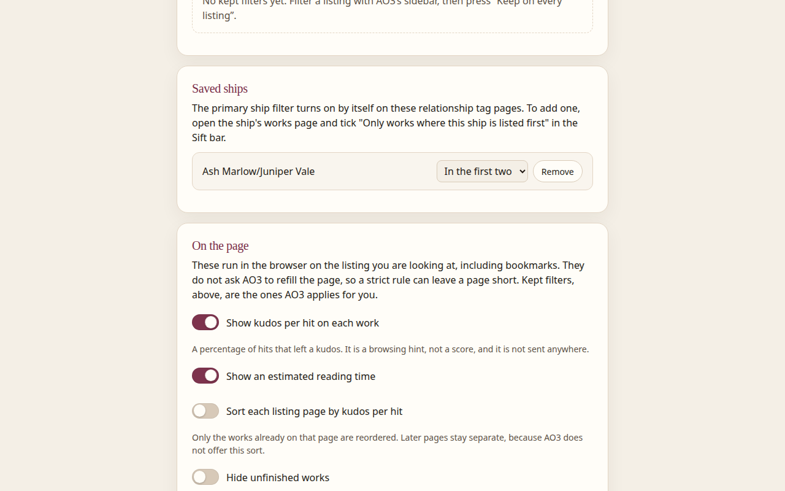

# Sift for AO3

**Block tags, mute authors, and keep your ship first on every AO3 search. See kudos rates and hide fics you already opened.**

[](https://chromewebstore.google.com/detail/nonieoiidaeaeheddaifgdmecgcbfgpl)
[](https://chromewebstore.google.com/detail/nonieoiidaeaeheddaifgdmecgcbfgpl)
[](https://github.com/cig13zs/sift-ao3/actions)
[](LICENSE)

[Install from the Chrome Web Store](https://chromewebstore.google.com/detail/nonieoiidaeaeheddaifgdmecgcbfgpl)

Sift is a private, offline browser extension for [Archive of Our Own](https://archiveofourown.org). Your lists stay in the browser. There is no account, no analytics, and no data sent to the author.

## Features

- **Primary ship filter** — On a relationship tag's works page, hide (or collapse) fics where that ship is not listed first, or optionally in the first two relationship tags. AO3 synonyms and subtags count as the same ship.
- **Saved tag exclusions** — Tags you exclude are added to AO3's own listing filter on every works or bookmarks listing you open via links on the site, so synonym tags are excluded and pages stay full.
- **Kept sidebar filters** — Complete/in-progress, language, crossover, and word-count choices from AO3's sidebar can be kept on every work listing, like exclusions.
- **Muted authors** — Hide works by an AO3 user on every listing, every pseud, including co-authored works, without logging in.
- **On the page** — Hide unfinished works, works outside a word-count range, or works that have not been updated in a chosen number of days. Highlight works updated recently. These rules also apply to bookmark listings, where AO3's own sidebar cannot.
- **Kudos per hit** — Each blurb can show what percentage of hits left a kudos, plus an estimated reading time. Sort the works already on the page by that rate. It is a browsing hint, not a score.
- **Opened works** — Optionally remember work ids you open, mark them on listings, and hide them. The list stays on this device.
- **Saved for later** — A private list, separate from AO3 bookmarks, from a Later button on any work.
- **Presets** — Name the filters you have now and apply that set again later.
- **Bulk exclude** — From a listing or a fic page, exclude the tags you tick, or every additional tag on that work, in one step.
- **Per-work panel** — Press **Sift** on any work to mute its author or exclude any of its tags.
- **Popup** — Hidden counts for this page and in total, saved-for-later links, an on/off switch, and a layout that fits a narrow window.
- **Options** — Manage lists, import/export JSON (including AO3 Savior-style backups and the new rules), and behaviour toggles.
- **Optional browser sync** — When you turn it on, exclusions, mutes, ships, kept filters, presets, and on-the-page rules sync through the browser account you already use. Opened works and saved-for-later stay on the device. Off by default.
- **Keyboard shortcut** — `Alt+Shift+S` toggles Sift (customize at `chrome://extensions/shortcuts`).

## Screenshots







## Permissions

| Permission | Why Sift needs it |
|------------|-------------------|
| `storage` | Save your exclusions, muted authors, ships, kept filters, presets, and on/off state in the browser. The same permission covers optional `storage.sync` through your browser account. Sift does not add a server. |
| `https://archiveofourown.org/*` (host) | Run the content script on AO3 only, rewrite listing links to carry your filters, and (when you enable a ship filter) fetch that ship's public tag page for synonym names — same origin only, no other sites. |

Sift does **not** request broad host access, `tabs`, scripting, or network permissions beyond AO3. Extension pages use a strict Content Security Policy: scripts load only from the package (`script-src 'self'`).

## Privacy

- Lists and settings live in extension storage on your device. They are not sent to the developer and are not sent to any server Sift controls.
- Cross-device sync is **off until you turn it on**. It uses the browser's own sync (the account you already signed the browser into). Opened-work ids and the saved-for-later list are never included.
- Sift does not record which works you open unless you turn remembering on. That list stays on the device.
- Sift does not use analytics, ads, or remote code.
- Filter data is sent **only to AO3**, in listing URLs (the same way AO3's own filter form works). Ship synonym lookup loads one public AO3 tag page per ship, at most about once a week per ship.
- See [PRIVACY.md](PRIVACY.md) for the full policy.

## Install

**Chrome, Edge, Brave:** [Chrome Web Store listing](https://chromewebstore.google.com/detail/nonieoiidaeaeheddaifgdmecgcbfgpl)

**Firefox:** Add-ons listing is in review. Until then, download `sift-ao3-*-firefox.zip` from the [latest GitHub release](https://github.com/cig13zs/sift-ao3/releases/latest), unzip, and load the folder as a temporary extension.

**Development / unpacked:** run `npm run build`, then in `chrome://extensions` enable Developer mode and **Load unpacked** → `dist/chrome/`.

## Development

Requirements: [Node.js](https://nodejs.org/) 20+ (CI uses 24).

```bash
npm ci
npm run lint    # syntax + manifest security checks
npm test        # unit tests (src/lib/sift.js)
npm run build   # dist/chrome, dist/firefox, and zip files
npm run e2e     # Playwright loads unpacked build against synthetic AO3 pages
```

See [CONTRIBUTING.md](CONTRIBUTING.md) for guidelines.

## Changelog

See [CHANGELOG.md](CHANGELOG.md). Latest store-facing release in this repo: **2.0.0**. Store copy: [STORE_LISTING.md](STORE_LISTING.md).

## Security

Report vulnerabilities privately: [GitHub security advisories](https://github.com/cig13zs/sift-ao3/security/advisories/new) ([SECURITY.md](SECURITY.md)).

## Support and license

Sift is free [MIT](LICENSE) software by [jju1s](https://ko-fi.com/jju1s). Bug reports and ideas: [GitHub issues](https://github.com/cig13zs/sift-ao3/issues).

Sift is unofficial and not affiliated with the Organization for Transformative Works or Archive of Our Own.

## More tools by the same author

Other projects by [cig13zs on GitHub](https://github.com/cig13zs):