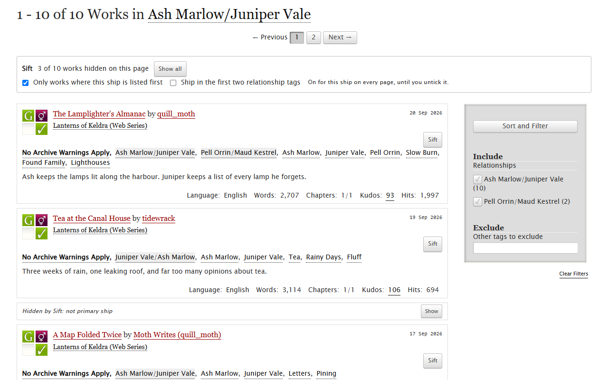
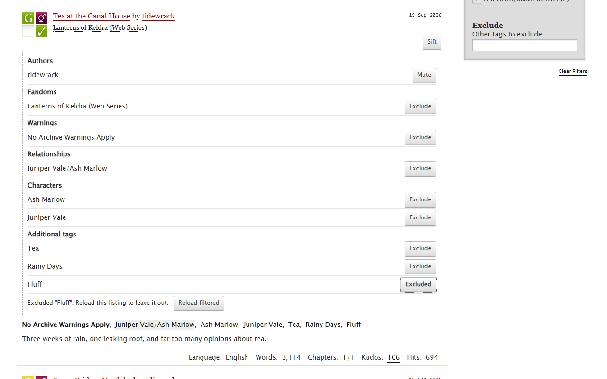

# Sift for AO3

Sift is a browser extension for reading on Archive of Our Own. It keeps your excluded
tags on for every listing and search, mutes authors even when you're logged out, and on
a ship's works page it can fold away the fics where that ship is only a side pairing.

## Your ship first

Open a relationship tag's works page and tick "Only works where this ship is listed
first" in the Sift bar. Works where the ship is a background pairing shrink to a
one-line bar with a Show button, so nothing is gone for good. Sift reads the tag's
"Tags with the same meaning" list on AO3, once a week per ship, which means
"Juniper Vale/Ash Marlow" counts as the same ship as "Ash Marlow/Juniper Vale".

If first place is too strict, tick "Ship in the first two relationship tags" as well.
The filter stays on for that ship until you untick it.

## Excluded tags that stay excluded

AO3's filter sidebar forgets your excluded tags as soon as you open another tag or
search. Press the Sift button on any work and choose Exclude next to a tag, or type
tags into the options page. After that, every link on AO3 that leads to a listing (tag
pages, searches, a user's works, bookmarks) carries your exclusions and AO3 does the
filtering itself. Synonym tags get excluded along with the tag, and pages stay full.

The same goes for AO3's other sidebar filters. Pick complete works only, a language,
no crossovers or a word count range in AO3's sidebar, press Sort and Filter, then press
"Keep on every listing" in the Sift bar. From then on every work listing and search you
open uses them too, until you remove them on the options page. A filter you change in
AO3's sidebar for one search still wins for that search.

If you land on a listing some other way, like a bookmark in your browser, the Sift bar
offers "Apply my filters". Turn on "always apply automatically" in the options and Sift
does it for you, once per page.

## Muted authors

Press Mute next to an author in the Sift panel. Their works fold away on every listing,
under every pseud, including works they co-wrote. This works without an AO3 account.
If you're logged in, AO3's own muting works too.

## Install

The Chrome Web Store and Firefox Add-ons listings are in review, and their links will go
here. Until then you can load it yourself in Chrome, Edge or Brave:

1. Download `sift-ao3-1.0.0-chrome.zip` from the [latest release](https://github.com/cig13zs/sift-ao3/releases/latest) and unzip it.
2. Open `chrome://extensions` and turn on Developer mode.
3. Choose "Load unpacked" and pick the unzipped folder.

## Privacy

Your excluded tags, muted authors and ship settings are saved in your browser's local
extension storage. They don't sync to your other devices, and they're never sent to me
or anyone else. A block list can say a lot about a person. Sift has no server to send it
to, and it doesn't use analytics or ads.

Sift talks to one website, AO3. Your excluded tags go to AO3 inside the listing address,
the same way AO3's own filter sends them. When you turn on the ship filter, Sift loads
that ship's public tag page to read its other names. The full policy is in
[PRIVACY.md](PRIVACY.md).

## Backups

The options page exports everything to a JSON file and imports it again. It also takes
the tag and author blacklists from AO3 Savior's settings. Patterns with a `*` can't
become AO3 filters, so Sift skips those and tells you how many it skipped.

## Limits

- Exclusions work where AO3 can filter: tag works pages, searches, users' works and
  bookmarks. Series pages aren't filtered. Kept sidebar filters (complete, language,
  crossovers, word count) apply to work listings and searches, not bookmarks.
- For the biggest ships, AO3's tag page may not list every alternative name. A work
  tagged with a rare one can fold by mistake, and it's still one click away.
- If AO3 changes its page layout, Sift may stop reading it. The toolbar popup says so
  instead of breaking the page.

## Support

Sift is free and MIT licensed. If it makes AO3 nicer to browse, you can
[buy me a coffee on Ko-fi](https://ko-fi.com/jju1s). Bug reports and ideas go in
[issues](https://github.com/cig13zs/sift-ao3/issues).

Sift is an unofficial project. It isn't affiliated with the Organization for
Transformative Works or Archive of Our Own.

## Development

`node --test tests/` runs the unit tests, `node build.mjs` builds both browsers into
`dist/`, and `node tests/e2e.mjs` loads the extension in Chromium against made-up AO3
pages.
